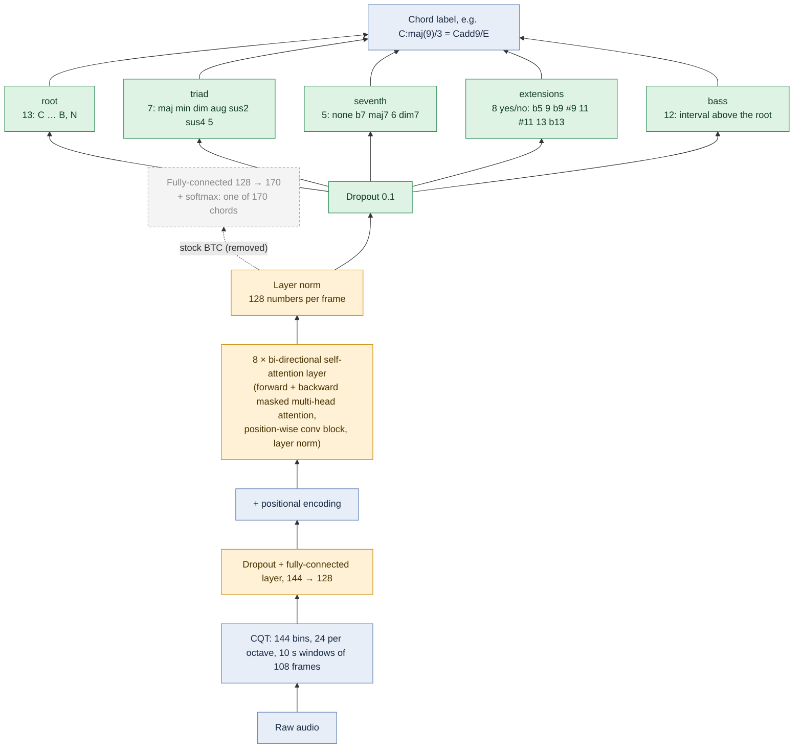

# Worship & Gospel Chord Recognition

Fine-tuning BTC (Bi-directional Transformer for Chord recognition) to recognise the extended and
slash chords common in worship and gospel music (G/B, Cadd9, E7sus4, maj9, 13ths). The full plan
is in PROJECT_NOTES.md.

```
btc_predictions 2/   481 draft .lab files: stock BTC output for the worship song collection
Annotate_Chords/     corrected .lab files, fixed by ear from the drafts (training labels)
training/            BTC fine-tuning with factorised heads (train.py, predict.py)
evaluation/          run_btc.py (stock BTC baseline), evaluate.py (mir_eval scoring)
labeling/            optional: audio + chord chart -> timed .lab labels (pipeline.py)
third_party/         BTC-ISMIR19 (git submodule, includes pretrained checkpoints)
runs/                training outputs (gitignored except configs)
```

Audio is not in the repo: it's copyrighted and gitignored. Keep it locally next to the labels.

## Setup

```bash
git submodule update --init                          # BTC code + pretrained weights
python3 -m venv .venv && source .venv/bin/activate
pip install torch torchaudio                         # CUDA build from pytorch.org on a GPU machine
pip install -r requirements.txt
```

`ffmpeg` must be on the PATH: audio is decoded with it, so MP3, M4A, WAV and FLAC all work.
Training only needs torch, librosa, mir_eval, numpy and PyYAML. Demucs, WhisperX and Beat This!
are only used by the optional labelling pipeline.

## The data

### Draft labels: `btc_predictions 2/`

One `.lab` file per song (`start  end  chord`, seconds), 297 at the top level and 184 in
per-song subfolders. Song names are mostly Indonesian and English worship songs, e.g.
`00020-0001 - Terbaik.lab`, `Send Revival/0113 - Send Revival.lab`.

These are **uncorrected stock BTC predictions** from the 25-class model: every chord is major,
minor or `N`, and every boundary sits on BTC's frame grid (10/108 s). They are a starting point
for annotation, **not** training targets. Training BTC on its own output teaches it nothing new,
and these labels contain none of the chords fine-tuning is meant to add (7ths, sus, add9, slash
chords).

### Corrected labels: `Annotate_Chords/`

Each draft is corrected by ear (e.g. in Sonic Visualiser) and saved to `Annotate_Chords/` under
the **same file name as the draft**, without any subfolder. The step-by-step workflow, the chord
cheat sheet and the labelling rules are in [Annotate_Chords/README.md](Annotate_Chords/README.md).
In short:

- Chords in Harte syntax: `G:maj`, `D:maj/3` (D/F#), `C:maj(9)` (Cadd9), `E:min7`, `G:sus4`
- `N` = silence or no harmony, `X` = harmony present but unclear (ignored in training)
- Label what is actually played, in the key of the recording
- Chord changes on the beat

### Audio

Put each song's audio in one folder (e.g. `audio/`), with the **same file name stem as its
label**: `audio/00020-0001 - Terbaik.mp3` + `Annotate_Chords/00020-0001 - Terbaik.lab`. Songs
without a corrected label are skipped.

## Baseline

Before fine-tuning, score stock BTC on the corrected labels so there's a number to beat:

```bash
python evaluation/run_btc.py --audio audio --out predictions/btc_large            # 170 classes
python evaluation/run_btc.py --audio audio --out predictions/btc_majmin --majmin  # 25 classes
python evaluation/evaluate.py --ref Annotate_Chords --est predictions/btc_large --out results/btc_large.csv
```

`run_btc.py` uses the submodule's code and checkpoints unmodified, with small shims so the 2019
code runs on numpy 2, PyYAML 6 and torch ≥ 2.6. It uses CUDA, then Apple MPS, then CPU.

Frames labelled `X` in the reference are ignored. Stock BTC can't output slash chords or
extensions, so expect its `*_inv` and `tetrads` scores to be the weakest; those are the metrics
fine-tuning should improve.

## Fine-tuning

### What changes in BTC

BTC is a CQT front end, a stack of 8 bi-directional self-attention layers, and a single
fully-connected + softmax layer that picks one of 170 chords. Fine-tuning keeps everything up
to the top of the attention stack, with its pretrained weights, and replaces only the output
layer with five small heads that each describe one part of the chord.



| Colour | Part | Starts from | Trained? |
|---|---|---|---|
| Blue | Audio, CQT features, positional encoding | Same as BTC | No weights to train |
| Yellow | Input projection, 8 attention layers, layer norm (the "backbone") | BTC's pretrained large-vocabulary checkpoint | Yes, gently (learning rate × 0.1) |
| Green | Five output heads | Random | Yes, fully |
| Grey, dashed | BTC's 170-class output layer | | Removed |

The attention layers themselves are unchanged: same 8 layers, 128 hidden units, 4 attention heads
and 108-frame window. Only their weights are nudged towards worship audio. The model stays at about
2.9M parameters.

Why five heads instead of one bigger list: the 170-class layer can't express slash chords or
add9/9/11/13 at all, and a list with every root × type × bass × extension combination would have
thousands of classes with almost no examples each. Split into parts, each head has only a few
choices to learn, and the parts combine into chords never seen as a whole (`F:7(b9,13)/3`).

### How it's trained

| Phase | Epochs | Backbone | Heads |
|---|---|---|---|
| 1 | 1–3 | Frozen | Trained, lr 3e-4 |
| 2 | 4 onwards (up to 60, early stopping) | Trained, lr 3e-5 | Trained, lr 3e-4 |

- Each example is a random 10 s clip, pitch-shifted by −5…+5 semitones (the root label moves with
  it) and with its volume changed by ±6 dB.
- `X` frames are ignored by every head. `N` frames train only the root head ("no chord").
- Rare triad, seventh and bass classes get more weight, so the model doesn't just predict
  "major, no seventh" everywhere.
- The best epoch is picked by `tetrads_inv` on the validation songs: the root, the full 4-note
  chord and the bass must all be right.

### Running it

Point the data source at your audio folder (`data.sources` in `training/config.yaml`, or on
the command line), then:

```bash
python training/train.py --set "data.sources=[{audio: audio, labels: Annotate_Chords}]"
python training/predict.py --ckpt runs/finetune/best.pt --audio <audio> --out <dir>
python evaluation/evaluate.py --ref Annotate_Chords --est runs/finetune/predictions/test
```

Songs are split by song into train / val / test (saved to `training/splits.json`; commit it so
the test set stays fixed). Songs listed under `data.test_only` in the config are never trained
on and are scored separately as `holdout`. See [training/README.md](training/README.md) for
the training details and a synthetic-data test you can run without any real data.

## Labelling from chord charts (optional)

`labeling/pipeline.py` builds timed labels from audio plus an untimed chord chart (ChordPro or
chords-over-lyrics), by separating the vocals, transcribing the words and placing each chord on
the beat where its word is sung. See [labeling/README.md](labeling/README.md).

```bash
python labeling/chord_utils.py                       # self-tests, no dependencies
python labeling/pipeline.py --songs <audio dir> --charts <chart dir> --out out --auto-transpose
```

Don't commit audio, chord charts or stems: they're copyrighted.
